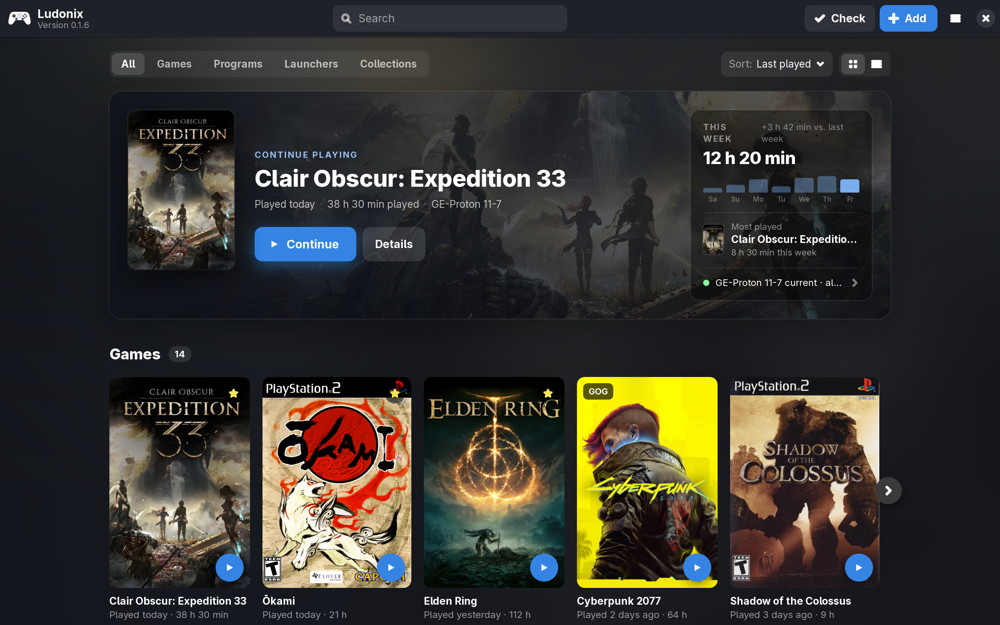
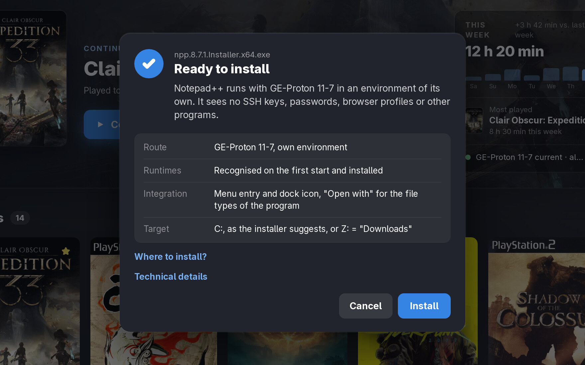
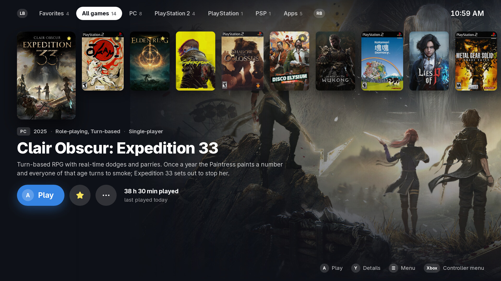
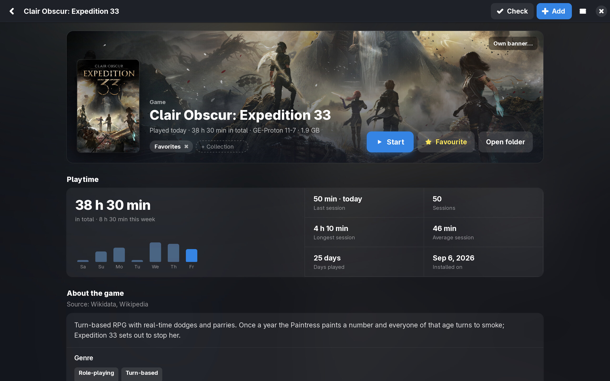

<h1 align="center">Ludonix</h1>

Windows programs, Windows games and console games on Linux, in one library. 
For Ubuntu 24.04 and newer (amd64). <a href="#install">Install</a>

Ludonix does not replace Wine or Proton. It reads a file before it starts it and picks the way it can run:

- Windows programs and games run through GE-Proton, each in an environment of its own. Visual C++, .NET and the other runtimes a file asks for are installed at its first start. If a program still crashes for a missing one, Ludonix installs it and starts the program again.
- Console games open in their emulator: PlayStation 1 to 3, PSP, GameCube and Wii, Nintendo 64, Switch, DS and Game Boy. A missing emulator comes from Flathub (RPCS3 from its makers) with one click.
- Programs with a better way on Linux, such as a native version, get a link to it.
- Games whose anti-cheat locks out Linux are not started, and the dialog says why.

Folders, archives (.zip, .7z, .rar), disc images and Windows shortcuts can be opened too. Ludonix finds the setup inside.

Windows programs do not get the run of your home folder. It is read-only for them, and SSH keys, password stores, browser profiles and other logins are hidden. Tools without any network code run offline.

## TV mode

The library in full screen, for the couch and a controller (Xbox, PlayStation or Nintendo layout). Emulators start full screen on the main monitor. The controller's Guide button opens a menu over the running game: save and load states, quit the game, battery of each controller.

## Game pages

Playtime per day and session, what the game is about, and the few settings that cannot be decided automatically: Proton version, GameMode, runtimes, Windows version, start arguments.

Games installed through a store launcher (GOG Galaxy, Battle.net and others) are listed one by one, not hidden behind the launcher. Any game can be added to Steam as a non-Steam shortcut, and Discord shows what you play.

The library in the screenshots is a demo. Game art belongs to its publishers.

## Install

Download [exe-runner_0.1.8_amd64.deb](https://simonlinuxcraft.github.io/ludonix/apt/exe-runner_0.1.8_amd64.deb) and install it from the folder it landed in:

    cd ~/Downloads && sudo apt install ./exe-runner_0.1.8_amd64.deb

The package adds this repository and its key, so updates arrive with the system's other updates.

Or add the repository first and install from it:

    wget -qO- https://simonlinuxcraft.github.io/ludonix/apt/exe-runner.gpg | sudo tee /usr/share/keyrings/exe-runner.gpg > /dev/null
    printf 'Types: deb\nURIs: https://simonlinuxcraft.github.io/ludonix/apt\nSuites: ./\nSigned-By: /usr/share/keyrings/exe-runner.gpg\n' | sudo tee /etc/apt/sources.list.d/exe-runner.sources > /dev/null
    sudo apt update
    sudo apt install exe-runner

Signing key: `047D304C3857A10BC4C6319ACB4B04B91587EFCD`

Changes per version: [CHANGELOG.md](CHANGELOG.md). Ludonix was called Exe Runner before version 0.1.6, and the package keeps that name. The apt repository lives in `apt/`, binary packages only. The source code is not public yet.
